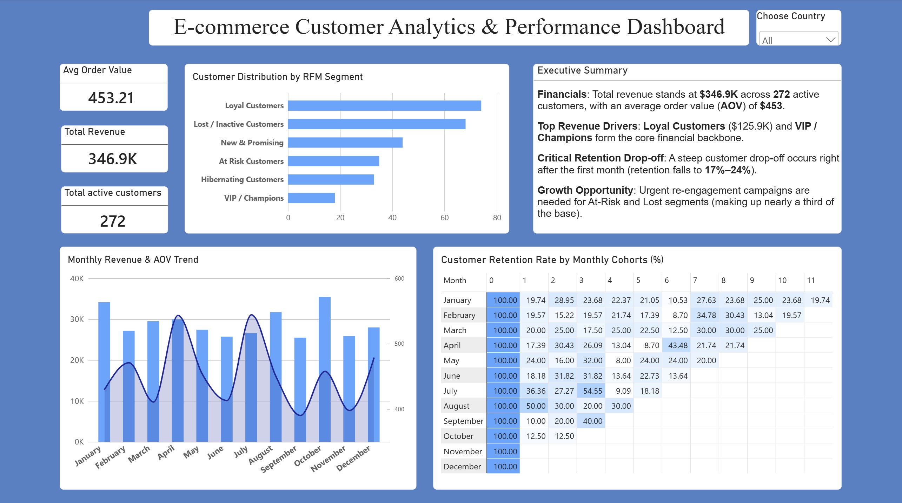

# E-commerce Customer Analytics & Performance Dashboard

## 📌 Project Overview
An end-to-end e-commerce customer and sales analytics project. The objective is to evaluate financial performance, analyze user stickiness through cohort retention, and segment the customer base using RFM logic to drive targeted CRM and retention campaigns.



---

## 💡 Executive Summary & Key Insights
* **Financial Performance:** Generated **$346.9K** in total revenue across **272** active customers, with an Average Order Value (**AOV**) of **$453**.
* **Top Revenue Drivers:** **Loyal Customers** ($125.9K) and **VIP / Champions** form the core financial backbone of the business, requiring dedicated retention and loyalty perks.
* **Critical Retention Drop-off:** A steep customer drop-off occurs immediately after the first month (retention rate falls to **17%–24%**). Automated onboarding and re-engagement triggers are recommended between days 30 and 45.
* **Growth Opportunity:** *At-Risk* and *Lost / Inactive* segments make up nearly a third of the customer base, presenting a major opportunity for win-back email campaigns and personalized discounts.

---

## 📊 Dashboard & Analytical Modules
1. **Executive KPIs:** High-level summary cards tracking Total Revenue, Total Active Customers, and Overall AOV.
2. **Sales Performance & AOV Trend:** Dynamic combination chart tracking monthly revenue fluctuations alongside AOV changes by country, preventing item-level double-counting.
3. **Customer Distribution by RFM Segment:** Behavioral breakdown categorizing customers into actionable tiers (*VIP / Champions*, *Loyal Customers*, *New & Promising*, *At Risk*, *Hibernating*, and *Lost / Inactive*) using custom business thresholds and quartiles.
4. **Cohort Retention Matrix:** Heatmap tracking monthly user retention rates (%) from Month 0 onwards, excluding incomplete current months to prevent metric skewing.

---

## 🛠️ Tools & Technologies Used
* **Google BigQuery (SQL):** Data extraction, multi-step CTE architecture, window functions (`NTILE`), date truncation, and behavioral segmentation logic.
* **Power BI Desktop:** Data modeling, DAX measures, interactive slicers, conditional formatting (heatmaps), and executive dashboard design.
* **GitHub:** Version control and portfolio documentation.

---

## 📁 Repository Structure
```text
├── Cohort analysis.sql                  # Monthly cohort retention query (BigQuery SQL)
├── Customer RFM Segmentation.sql        # RFM scoring and customer tiering query (BigQuery SQL)
├── Sales Performance & AOV Analysis.sql # Revenue and AOV aggregation query (BigQuery SQL)
├── ecommerce_analytics_dashboard.pbix   # Interactive Power BI report file
└── dashboard_preview.jpg                # High-resolution dashboard screenshot
